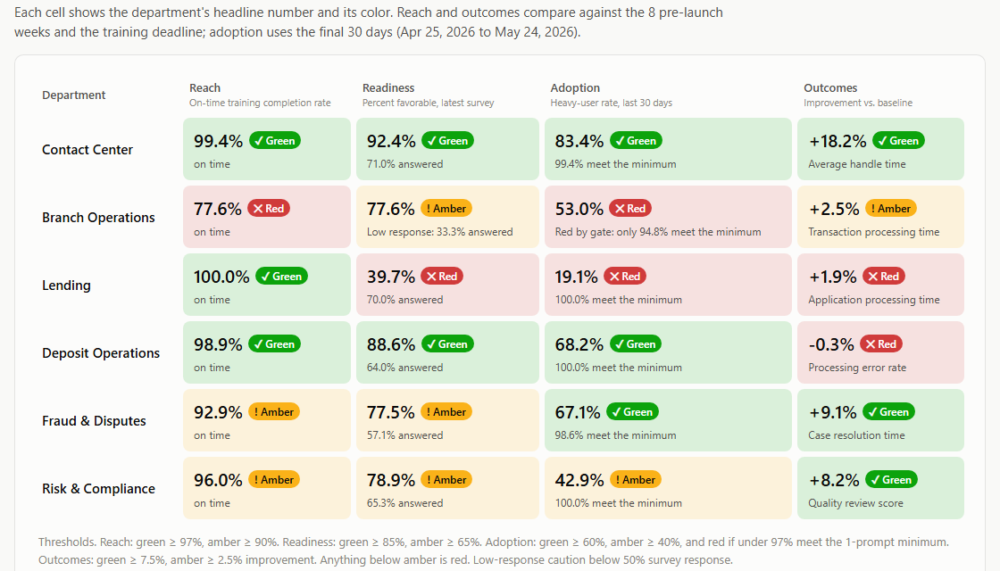

# Change & AI Adoption Readiness Scorecard

**Did this change actually take hold, and where do we need to act?**

A working scorecard that answers the question leaders ask after every rollout. It measures **reach, readiness, adoption and outcomes** by department, flags where adoption lags in red/amber/green, and writes a plain-language summary of where to act.

The first scenario models a bank rolling out a generative AI assistant to its employees. The framework is driven by one settings file, so the same code can measure any rollout: a new process, a new system or a new tool.

**[View the live dashboard](https://anomalychick.github.io/readiness-scorecard/)** · [Findings summary](output/findings_summary.md)

> **All data is synthetic.** Monolith National Bank, AI Assistant HAL and all 600 employees are fictional. No real employer or customer data is used anywhere in this project.



---

## The business problem

Organizations roll out new tools, systems and processes constantly, and AI tools are the latest wave. Most rollouts are judged on activity ("90% of people were trained"). That says little about whether behavior changed or whether the business improved.

This scorecard follows the whole chain, department by department, and shows **where it breaks**:

```
Reach          ->  Readiness       ->  Adoption       ->  Outcomes
(got trained)      (feel prepared)     (actually use)     (work improves)
```

A department can be fully trained but not trust the tool, or use it heavily without results. Each failure point calls for a different fix.

## What it found (synthetic scenario)

| Department | Reach | Readiness | Adoption | Outcomes | Where the chain breaks |
|---|---|---|---|---|---|
| Contact Center | 🟢 99.4% | 🟢 92.4% | 🟢 83.4% | 🟢 +18.2% | Nowhere. Share what's working. |
| Branch Operations | 🔴 77.6% | 🟡 77.6%\* | 🔴 53.0%† | 🟡 +2.5% | Training ran late on a short-staffed floor |
| Lending | 🟢 100% | 🔴 39.7% | 🔴 19.1% | 🔴 +1.9% | Trained, but don't trust the output: box-checking |
| Deposit Operations | 🟢 98.9% | 🟢 88.6% | 🟢 68.2% | 🔴 −0.3% | Heavy use, no results |
| Fraud & Disputes | 🟡 92.9% | 🟡 77.5% | 🟢 67.1% | 🟢 +9.1% | Slow start, recovering |
| Risk & Compliance | 🟡 96.0% | 🟡 78.9% | 🟡 42.9% | 🟢 +8.2% | Moderate across the board |

\* Low response: only 33% answered the survey. † Red by the minimum-use gate: only 94.8% used the tool at all.

**Training is where behavior changed.** The tool went live before anyone was trained. Across the bank, employees used it on **14.1%** of workdays before their own training and **32.1%** after.

These patterns were deliberately planted in the synthetic data. The point is that **the SQL finds them from the data alone**, and the tests confirm it does.

## How each measure works

| Measure | Headline number | Green | Amber | Notes |
|---|---|---|---|---|
| **Reach** | On-time training completion | ≥ 97% | ≥ 90% | Mandatory training; employees on leave during the window are excluded |
| **Readiness** | % of survey answers rated 6–7 on a 7-point scale | ≥ 85% | ≥ 65% | Optional surveys; caution flag under 50% response |
| **Adoption** | % heavy users (5+ active days in a rolling 30) | ≥ 60% | ≥ 40% | Red regardless if under 97% used it at all |
| **Outcomes** | Improvement vs. the pre-launch baseline | ≥ 7.5% | ≥ 2.5% | Each department's own metric, volume-weighted |

Anything below amber is red. Full definitions are in [`rollout_config.toml`](rollout_config.toml) and on the dashboard.

### Design choices drawn from real bank practice

- **Mandatory training means completion isn't the signal.** When misses escalate to skip-level managers, nearly everyone finishes eventually. The real difference is *on time* vs. *after escalation*, so green is 97%.
- **Leave of absence is excluded, not counted as a miss.** Anyone on leave during a measurement window has no full performance record for that period. They're left out of both numerator and denominator and shown as a count.
- **Scorecard pressure creates box-checking.** Tool use appears on performance scorecards, so one prompt a month "meets" and almost everyone does it. The headline is *heavy* use (5+ active days), and a minimum-use gate catches true non-users.
- **The registration link is only in the invitation and reminder emails.** Nobody can register without opening one, and the tests enforce it.
- **Monitoring, not an experiment.** The scorecard shows where use and results *line up*. Proving the tool *caused* a gain would need a comparison group or a staggered rollout.

## How it's built

| Layer | Tool | Files |
|---|---|---|
| Settings | TOML | `rollout_config.toml`: timeline, departments, thresholds, recommended-action playbook |
| Synthetic data | Python (standard library) | `src/generate_data.py`: 600 employees, emails, training, surveys, daily usage, weekly outcomes |
| Metrics | SQLite + SQL views | `src/load_database.py`, `sql/01_reach.sql` … `sql/05_scorecard.sql` |
| Findings | Python, rule-based | `src/write_summary.py`: every sentence quotes its numbers; actions come from the playbook |
| Dashboard | HTML + Chart.js | `src/build_dashboard.py`, `src/dashboard_template.html` → `output/dashboard.html` |
| Validation | pytest (72 tests) | `tests/`: 25 business rules, metric sanity, independent recalculation, planted patterns |

The SQL reads every date and threshold from a one-row `settings` table, so changing the settings file changes the scorecard without touching any SQL. The metric code never sees how the synthetic data was generated.

## Run it yourself

Requires Python 3.11 or newer. The pipeline uses only the standard library.

```bash
python run_all.py                 # generate data -> database -> metrics -> summary -> dashboard
# then open output/dashboard.html in a browser

pip install -r requirements.txt   # pytest, for the tests only
python -m pytest                  # 72 tests
```

The same random seed gives identical data on every run.

## Project structure

```
rollout_config.toml      the rollout: timeline, departments, thresholds, playbook
run_all.py               runs the whole pipeline
src/                     generator, loader, metrics runner, summary writer, dashboard builder
sql/                     one SQL file per measure + the scorecard
tests/                   pytest validation suite
output/                  dashboard.html, findings_summary.md (metrics CSVs are regenerated, not stored)
data/                    generated CSVs and SQLite database (regenerated, not stored)
```

## About

Built by **Audrey Apelbaum** ([@Anomalychick](https://github.com/Anomalychick)) with [Claude Code](https://claude.com/claude-code). The author defined the requirements and every business rule, reviewed and tested each step, and validated the numbers by hand. Claude Code wrote most of the code.
